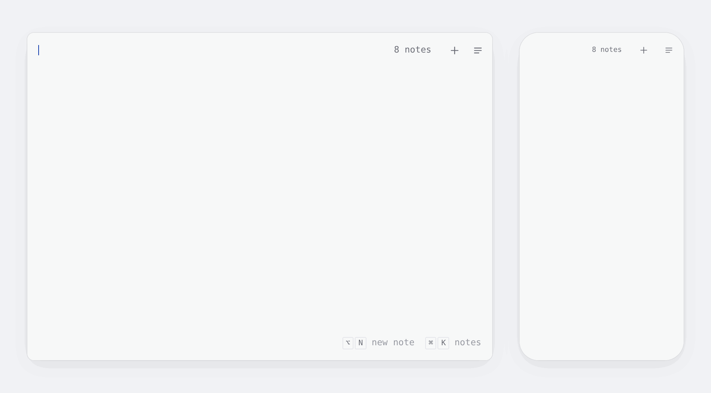

# Literal

Instant notes, on all your devices.

<picture>
  <source media="(prefers-color-scheme: dark)" srcset=".github/demo-dark.gif" />
  
</picture>

Open [literal.ink](https://literal.ink) and start typing. Your notes save as you go, and signing in syncs them across your devices.

## How it works

- **App:** Solid, an installable PWA that works offline (`app/`).
- **Server:** a Cloudflare Worker, with D1 for accounts and a Durable Object per person for their notes (`worker/`).
- **Sync:** each note is a Yjs document, so edits from any device merge without conflicts.

## Develop

```sh
pnpm install
cp .dev.vars.example .dev.vars
pnpm wrangler d1 migrations apply literal --local --persist-to .wrangler/state
pnpm dev
```

Sign-in codes show up in the terminal. `pnpm check` checks types, lint and formatting (`pnpm format` fixes it), and `pnpm test` runs the tests.

## License

[MIT](LICENSE)
